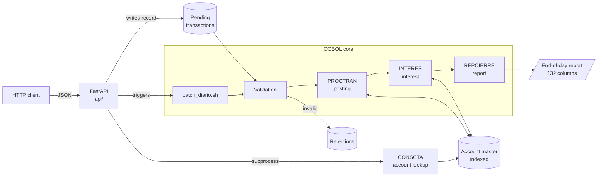

# Proyecto COBRA

[](https://github.com/AxelEspinosa94/COBRA/actions/workflows/ci.yml)

**COBOL Batch + REST API**: a COBOL banking batch-processing core, exposed through a modern Python API (FastAPI).

> 🚧 **Work in progress.** This README describes the target architecture. Progress is tracked on the [project board](../../projects) and in the [milestones](../../milestones).

---

## Why this project?

A large share of the world's financial systems still runs on COBOL. Rewriting them is expensive and risky, so the most common strategy is to **modernize without rewriting**: keep the proven core and wrap it with modern interfaces.

COBRA is a use case for that strategy:

- The **COBOL core** does what COBOL does best: process batches of transactions over indexed files with exact decimal arithmetic.
- The **Python layer** exposes that core as a REST API without touching the business logic.

The design can be extended to other domains that rely on batch processing, such as payroll, insurance or inventory.

---

## Architecture



### Daily batch flow

| Step | Program | Description |
|------|---------|-------------|
| 0 | `CARGACTA` | Initial load: converts the sequential accounts file into an indexed master file (first run only) |
| 1 | Validation | Checks each transaction against the master and sends invalid ones to the rejections file |
| 2 | `PROCTRAN` | Posts deposits, withdrawals, transfers and fees to the master |
| 3 | `INTERES` | Calculates and credits daily interest on savings accounts (360-day convention) |
| 4 | `REPCIERRE` | Generates the end-of-day report with control breaks and totals |

The `scripts/batch_diario.sh` script chains the steps the way a JCL job would: if a step ends with a non-zero return code, the chain stops.

---

## Repository structure

```
COBRA/
├── src/                 # COBOL programs (.cbl)
├── copybooks/           # Shared record definitions (.cpy)
├── data/
│   ├── entrada/         # Sample input files (versioned)
│   └── salida/          # Batch output (not versioned)
├── tests/
│   ├── fixtures/        # Fixed input data for tests
│   └── golden/          # Expected outputs (regression tests)
├── api/                 # FastAPI service
├── scripts/             # Data generator and batch orchestrator
├── bin/                 # Compiled executables (not versioned)
├── .github/workflows/   # CI with GitHub Actions
├── Makefile
└── README.md
```

---

## Stack

| Component | Technology |
|-----------|------------|
| Batch core | COBOL (GnuCOBOL 3.x) |
| Files | Sequential and indexed (`ORGANIZATION IS INDEXED`) |
| API | Python 3.12 + FastAPI + Pydantic |
| Testing | `diff` against golden files (batch) and `pytest` (API) |
| CI | GitHub Actions |
| Packaging | Docker / Docker Compose |

---

## Requirements

- Linux or WSL (Ubuntu 22.04 or later)
- GnuCOBOL 3.x
- Python 3.12
- `make`

```bash
sudo apt update
sudo apt install -y gnucobol build-essential make python3.12 python3.12-venv
cobc --version
```

installation check

```bash
cobc --version
cobc --info | grep -i indexed
cat > hola.cbl <<'EOF'
       IDENTIFICATION DIVISION.
       PROGRAM-ID. HOLA.
       PROCEDURE DIVISION.
           DISPLAY "Hola desde COBRA".
           STOP RUN.
EOF
cobc -x hola.cbl && ./hola && rm hola hola.cbl
```

`--version` should be 3.x.x, the second line should output something like `indexer file handler: BDB`

---

## Usage

> The commands in this section describe the target version and will become available as the milestones are completed.

### Build

```bash
make            # compiles every program in src/ into bin/ (lint + compilation)
make clean      # removes binaries and generated files
```

### COBOL Makefile test

```bash
make
make run
make test
```

> To add new subprograms, add it in MODULOS variable in Makefile

### Generate test data

```bash
python3 scripts/generar_datos.py --cuentas 100 --transacciones 1000 --semilla 42
```

### Run the daily batch

```bash
./scripts/batch_diario.sh
```

### Start the API

```bash
python3 -m venv .venv && source .venv/bin/activate
pip install -r api/requirements.txt
uvicorn api.main:app --reload
```

Or with Docker:

```bash
docker compose up
```

Interactive documentation is available at `http://localhost:8000/docs`.

### Tests

```bash
make test               # batch regression tests
pytest tests/           # API tests
```

---

## API (proposed)

| Method | Endpoint | Description |
|--------|----------|-------------|
| `GET`  | `/cuentas/{numero}` | Account balance and status lookup |
| `POST` | `/transacciones` | Queues a transaction for the next batch run |
| `POST` | `/batch/ejecutar` | Triggers the daily batch |
| `GET`  | `/batch/ultimo-reporte` | Returns the latest end-of-day report |
| `GET`  | `/health` | Service health check |

---

## Rejection codes

These will be finalized in milestone **M2 - Núcleo batch**. Planned codes include:

| Code | Reason |
|------|--------|
| `R01` | Account does not exist |
| `R02` | Account is blocked or closed |
| `R03` | Invalid amount (zero or negative) |
| `R04` | Insufficient funds |
| `R05` | Unrecognized transaction type |
| `R06` | Invalid destination account, or same as source |

---

## Roadmap

- [ ] **M1 - Setup:** structure, Makefile and CI
- [ ] **M2 - Batch core:** copybooks, initial load, validation, posting, interest and report
- [ ] **M3 - Batch tests:** golden-file regression and edge cases
- [ ] **M4 - API layer:** FastAPI, account lookup subprogram and Docker
- [ ] **M5 - Documentation:** demo and design decisions

---

## License

MIT